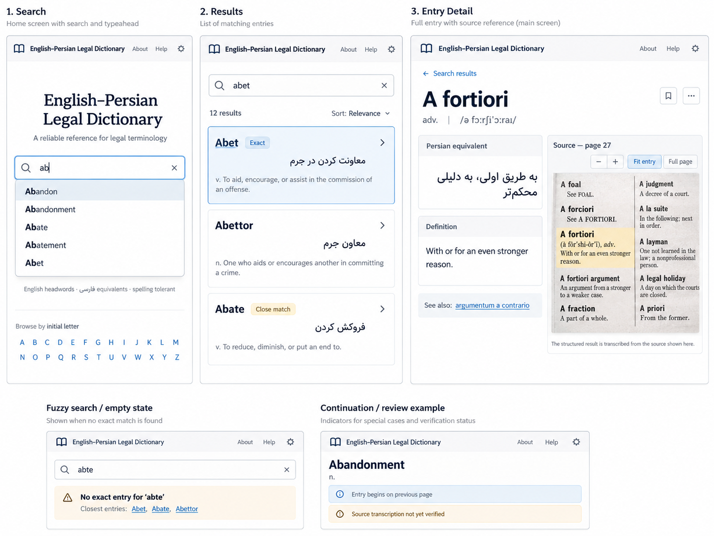

# English–Persian Legal Dictionary — UX/UI Proposal 01

UX/UI proposal · document v1.0 · 22 October 2026

Status: proposed design approved in direction (layout, typography and scale), pending final content and identity details.

Primary visual reference: UX mockup included in Appendix A and separately supplied as PNG. If a written description and the mockup disagree on visual styling, use the mockup for visual direction; use this document for interaction and behavior rules.

# 1. Product intent

A fast, text-first lookup interface for a digitized printed English→Persian legal dictionary. It is a source-backed reference tool, not a translator or chatbot. Every opened entry exposes the original book crop so a legal reader can verify the transcription.

The three primary outputs are the Persian equivalent, English definition, and scanned source crop. If a requested term is not explicitly present in the dictionary, the interface must say so rather than fabricate an equivalent.

# 2. Scope and assumptions

- ~10,000 entries across ~430 scanned, two-column pages. English is LTR; Persian is RTL.

- Desktop-first responsive website; usable on narrow screens.

- One combined search field covering exact/prefix English headwords, fuzzy English headwords, and Persian equivalent keyword search.

- Question-in-a-sentence and chat behavior are out of scope (decided). Do not imply they are supported.

- Author’s name belongs in the app’s full title and is described on an About page. Exact author name, preferred spelling, book title and bibliographic data are not yet provided. Use placeholders until confirmed.

# 3. Brand, title and page identity

Recommended long product title: “Mansoor Mokhtari’s English–Persian Legal Dictionary”. For compact navigation, use “Mokhtari · Legal Dictionary” if space requires shortening. Author name supplied by the owner; biography and exact credit wording still pending (Q3).

| Surface       | Required treatment                                                                                                                                        |
|---------------|-----------------------------------------------------------------------------------------------------------------------------------------------------------|
| Browser title | Mansoor Mokhtari’s English–Persian Legal Dictionary \| Search / \[Entry\] / About                                                                          |
| App masthead  | Book outline icon + author-inclusive title, with a responsive compact form                                                                                |
| Home heading  | Full author-inclusive title and brief search purpose                                                                                                      |
| About         | Author and source-book attribution, bibliographic details, digitization/transcription explanation, source-use and contact/legal information as applicable |
| Source area   | Book page number and source scan, separate from app attribution                                                                                           |

# 4. Visual baseline — preserve the approved mockup

Visual direction: professional legal reference, quiet and clean. White/off-white canvas, deep navy primary text, muted blue actionable accents, thin light-gray rules, slight card corner rounding and minimal shadow. Avoid gradient treatments, chat bubbles, illustrations, oversized badges and decorative ornament.

The mockup shows layout proportions and type hierarchy, not an exported design-token file. Measurements below are STARTING TARGETS inferred from its appearance, not claimed exact measurements; compare final browser screenshots side by side with Appendix A before sign-off.

| Visual element       | Starting target / rule                                                                    |
|----------------------|-------------------------------------------------------------------------------------------|
| Fonts                | English/UI: Inter (system-ui fallback); Persian: Vazirmatn with suitable Persian fallback |
| Main page background | White to very light cool gray; \#FFFFFF / approx. \#F8FAFC                                |
| Main text            | Deep navy/charcoal; approx. \#12203A                                                      |
| Accent / links       | Muted medium blue; approx. \#1263B4                                                       |
| Lines and borders    | Thin cool gray; approx. \#D9E1EA                                                          |
| Main heading         | ~30–34 px on desktop, strong weight; much smaller on mobile                               |
| Result headword      | ~20–22 px semibold/bold                                                                   |
| Persian translation  | ~20–24 px, RTL, line-height ~1.6                                                          |
| Definition/body      | ~15–16 px; secondary labels ~12–13 px                                                     |
| Search box           | ~46–50 px high, rounded ~6–8 px, thin border and blue focus ring                          |
| Cards and rows       | ~8 px corner radius; 14–18 px interior padding; 12–16 px vertical rhythm                  |
| Main content width   | Centered desktop container; readable text width; no edge-to-edge stretching               |
| Detail split         | Text ~45–55% / source ~45–55%, depending on screen width                                  |

Do not treat these values as an instruction to re-style the mock. The visual image takes precedence for subjective density, size, spacing and feel. Source imagery can carry the character of the book; the app text should remain modern and legible.

# 5. Screen inventory and navigation

| Screen              | Key elements / behavior                                                                                                                                                          |
|---------------------|----------------------------------------------------------------------------------------------------------------------------------------------------------------------------------|
| S1 · Search / home  | Masthead, prominent title, single search field, typeahead dropdown, search helper line, secondary A–Z browsing strip.                                                            |
| S2 · Search results | Persistent search in top area; results count; rows with headword, Persian equivalent and 1–2 line English definition snippet. Exact and close-match badges only when meaningful. |
| S3 · Entry detail   | Back-to-results, headword/POS/pronunciation, Persian equivalent, English definition, internal cross-references, visible source panel with zoom/context and page ID.              |
| S4 · About          | Author attribution and book information, what was digitized, transcription/source limitations, relevant acknowledgments and contact/copyright details.                           |

A–Z browsing does not need its own R1 screen. Clicking a letter opens the standard results view filtered by that initial. The maintainer review interface is a distinct internal workflow and is not part of the public screen inventory.

Suggested routes (not implementation contracts): /, /search?q=..., /entry/:id, /about. Preserve the search query and prior list scroll position when returning from an entry.

# 6. Layout specification

## 6.1 Search screen

- Title centered above the search field with generous whitespace, consistent with the first panel of the approved image.

- One large field: “Search English or فارسی”. Magnifier at start and clear action when non-empty.

- Helper line: “English headwords · فارسی equivalents · spelling tolerant”.

- Typeahead under input displays headwords (e.g., Abandon, Abandonment, Abate). Highlight the matching prefix in each suggestion.

- A–Z browse row below, deliberately less prominent than search.

## 6.2 Results screen

- Search remains editable. A small results count follows; only show sort control if ranking/order alternatives actually exist.

- Rows show English headword as the primary title; Persian equivalent as separate, right-aligned RTL block; compact definition preview and POS in LTR below.

- Rows can use light outlines and modest spacing as pictured. The opened/active result may have a muted blue outline.

- Do not show scan crops in the result list. They belong in detail.

## 6.3 Entry detail screen

<table>
<colgroup>
<col style="width: 100%" />
</colgroup>
<thead>
<tr class="header">
<th>← Search results [app title / About] 
 
A fortiori adv. pronunciation 
┌────────────────────────┐ ┌────────────────────────────┐ 
│ Persian equivalent │ │ Source — page 27 │ 
│ [RTL Farsi] │ │ [−] [+] [Fit] [Full page] │ 
├────────────────────────┤ │ scanned original crop │ 
│ Definition │ │ softly highlighted entry │ 
│ English definition │ │ adjacent entries visible │ 
└────────────────────────┘ └────────────────────────────┘ 
See also: [linked term]</th>
</tr>
</thead>
<tbody>
</tbody>
</table>

On desktop, the readable entry and scan sit alongside one another. On narrow screens, stack headword → translation → definition → source. The source remains visible without an additional reveal gesture.

# 7. Search interaction contract

1.  Initial state: empty single search field. For English input, present matching headword suggestions as the user types; a short debounce is acceptable but no submit is required for suggestions.

2.  English prefix input: “ab” shows matching headwords starting with ab; highlight the prefix. This is not labeled “prefix match”.

3.  Exact English input: sort exact matches before prefix and unrelated fuzzy candidates. Mark matching records “Exact” when doing so distinguishes match quality.

4.  Typo input: “abte” yields “No exact entry for ‘abte’” followed by clearly grouped “Closest entries” from fuzzy matching; label individual non-exact candidates “Close match” if necessary.

5.  Persian input: automatically search translation_fa; input writing direction and alignment switch to RTL. Show temporary helper “Searching Persian equivalents”; do not change the overall app shell to RTL.

6.  Result click/keyboard selection: open full entry with the scan alongside it. Browser back and back-to-results preserve the query and scroll position.

7.  Zero candidates: show an explicit “No dictionary entry found for …”, with concrete prompts to shorten the phrase or try another spelling. Never generate an unsupported Farsi translation.

Input-direction detail: use the first strong directional character to determine field direction; don’t force RTL merely because a mixed-language query contains a Persian character later in the string. Search text should be normalized for common Persian/Arabic variants (ی/ي, ک/ك, diacritics, half-space patterns) without changing source text displayed to users.

# 8. Tricky cases — one recommended treatment each

## 8.1 Bilingual content

English and Persian occupy independent blocks, not one interleaved line. The Persian block is right-aligned, dir=rtl, with larger line-height and a font designed for Persian. English metadata, definition and application navigation remain LTR. Preserve punctuation and mixed-script spans in the source wording.

## 8.2 Source scan as the trust layer

Always display the source crop on detail. Default view fits the target entry with modest preceding/following context and soft highlight. Show “Source — page N” and simple zoom − / +, Fit entry, Full page. Full-page view allows pan/zoom through the original two-column scan and makes the original entry location apparent. Do not surface bounding-box coordinates or OCR metrics to ordinary users.

## 8.3 Match affordances

No exact/prefix/fuzzy/Persian search mode tabs. Use the single input and disclose retrieval differences only when material: “Exact” on exact entries, “Close match” and “No exact entry…” for fuzzy suggestions, temporary Persian mode helper. Never show arbitrary confidence percentages.

## 8.4 Page/column continuations

Assemble and display full content as one coherent entry. In the source panel, indicate “Source spans pages 112–113” or “Entry begins on previous page,” as applicable; display the relevant crops together in reading order. Do not label the definition itself as incomplete if the text has been fully assembled.

## 8.5 Review flags

needs_review is an internal extraction-QA flag; users never see it. Flagged entries are excluded from public search until human-reviewed, so no end-user notice exists. Maintainers get separate flag state, extraction confidence where available, edit and mark-verified tools. Review UI is not part of the public detail view.

## 8.6 No results and ambiguity

Distinguish “term not explicitly in this dictionary” from “nothing remotely similar found.” For fuzzy-only hits, say “No exact entry for \[query\]” above “Closest entries.” If several exact headword records/senses exist, display them separately with enough definition context, and never silently merge different senses or imply a fuzzy match is authoritative.

# 9. Data model mapping

| Record field    | UI use                                                                                |
|-----------------|---------------------------------------------------------------------------------------|
| headword_en     | Primary headword; exact and prefix search                                             |
| translation_fa  | RTL equivalent block; Persian keyword search                                          |
| definition_en   | Full English definition; truncated result preview; preserve embedded Persian examples |
| pos             | Compact part-of-speech metadata                                                       |
| pronunciation   | Optional secondary headword metadata; omit gracefully when absent                     |
| source_image    | Target crop, page identifier and entry highlight; full-page context                   |
| is_continuation | Provenance annotation and multiple crop composition                                   |
| needs_review    | Internal only; excluded from public search until reviewed; prominent maintainer flag          |

Cross-references like “see also X” remain inside the parent entry and become internal links only when the target is identifiable. Persian example sentences embedded in the definition are not separate search results or records.

# 10. About page and author attribution

Add a simple, text-first About page, accessible from the global header on all screens. Design treatment must match the mockup’s restrained typography, narrow prose measure and light separators. Suggested section order:

8.  Dictionary title, author’s full credited name, author biography (approved text only).

9.  Original printed book: exact title, edition, publisher, year, ISBN (if available), and source acknowledgment.

10. About this digital edition: English→Persian legal lookup, source-scan verification, extraction/transcription process described carefully.

11. Limitations: an entry only reports what this particular dictionary contains; close-match suggestions are not equivalents. Source scan takes precedence over transcription in a discrepancy.

12. Credits/contact/copyright and permitted usage wording, as confirmed by the owner.

The cover/app heading and the About page should not assume that the dictionary author and website creator are the same person. This distinction must remain explicit.

# 11. Responsive, keyboard and accessibility requirements

- Desktop: 2-column detail; mobile: stacked details with scan below the text and an obvious Full page action.

- Ensure scan viewer zoom controls are keyboard reachable; typeahead arrow keys, Enter selection and Escape dismissal should work.

- Visible focus indicators and semantic headings, labels and status messages. Do not signal fuzzy or review state using color alone.

- Persian text remains selectable/copyable; rendered RTL text may wrap over multiple lines. Avoid truncating the authoritative full equivalent or definition.

- Source images need meaningful descriptive labels (page and headword) and must have a visible fallback/error state if unavailable.

# 12. Copy and UI states

| Trigger              | Proposed UI copy                                                                   |
|----------------------|------------------------------------------------------------------------------------|
| Empty field          | Search English or فارسی                                                            |
| Persian detection    | Searching Persian equivalents                                                      |
| Fuzzy-only           | No exact entry for “abte” · Closest entries                                        |
| No candidates        | No dictionary entry found for “\[query\]”. Try a shorter term or another spelling. |
| Review flag          | (internal — not shown to end users)                                              |
| Spanning entry       | Source spans pages \[N\]–\[N+1\]                                                   |
| Prior page start     | Entry begins on previous page                                                      |
| Source heading       | Source — page \[N\]                                                                |
| Attribution reminder | Transcribed from the printed source shown here.                                    |

# 13. UX risks, non-goals and acceptance checks

Risks to verify with real records: multiple senses and extraction duplicates; cross-reference resolution; Persian normalization; scan resolution and legibility; long English definitions with embedded Persian; multi-crop continuations; distinction between book authority and a digitized transcription.

Explicit R1 non-goals: translation of missing headwords, chatbot Q&A, generated legal advice, mandatory advanced-search tabs, separate browse page, and user-facing OCR/debug controls.

Design acceptance checks:

- A user can find an exact English term, recognize prefix suggestions, and open source evidence without an extra disclosure click.

- A Farsi query searches equivalents with a right-aligned RTL input; result content preserves both writing directions.

- A typo yields clear close matches, without presenting them as exact dictionary entries.

- A continuation presents all source pieces without fragmenting the extracted content.

- A flagged transcription gives a restrained, accurate warning while allowing source verification.

- The author-inclusive app title and About page convey correct bibliographic credit.

- Side-by-side screenshot review confirms layout, fonts, scale and whitespace remain faithful to Appendix A.

# 14. Open content dependencies (not product-design blockers)

| ID  | Input needed before publishing                                                                           |
|-----|----------------------------------------------------------------------------------------------------------|
| Q1  | RESOLVED — author: **Mansoor Mokhtari**. Exact credit-line wording (English and/or Persian) still to confirm. |                       |
| Q2  | Original book title, publisher, edition, publication year, ISBN and rights/permission wording.           |
| Q3  | Approved About-page biography, editor/digitization credits and contact/ownership copy.                   |
| Q4  | Representative real scanned pages and crops including two-column entries and page-spanning continuation. |
| Q5  | RESOLVED — needs_review is an internal extraction-QA flag; users never see it; flagged entries excluded until reviewed. |

# Appendix A — approved visual reference

This image is a design reference, not a verified screenshot of a functioning application. It contains illustrative source text and examples. Follow its styling and proportions while using actual dictionary content and correct bibliographic data in the product.

Reference: English–Persian Legal Dictionary UX concept board (Search, Results, Entry Detail, and special states).
